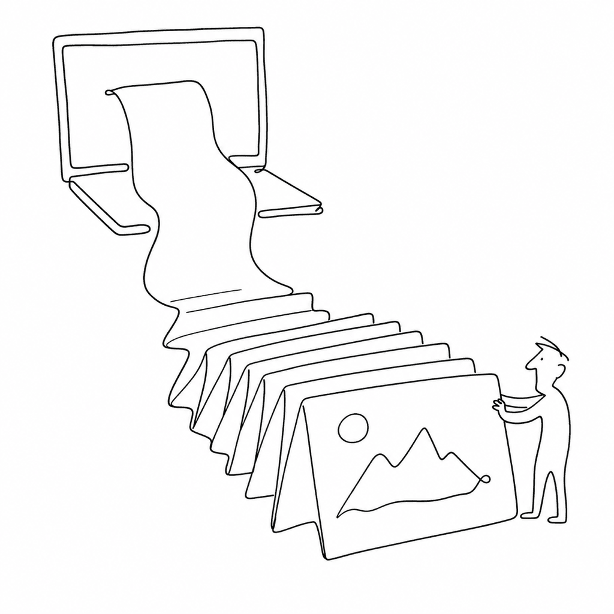

# vexy-dexyjs

`vexy-dexyjs` turns a web page into slides, in the browser.

{ width="320" }

It is a small, dependency-free DOM preprocessor. You run it inside a page that
is already loaded. It rewrites that page into a flat list of
`<section class="slide">` elements and tags each one with a shared set of layout
classes. A slide renderer such as reveal.js, or CSS paged media, can then take
the result and print it to PDF.

Because it runs where the page already lives, fonts, stylesheets and images stay
loaded. Nothing is downloaded and rewired offline.

`vexy-dexyjs` is the generalized successor to
[`webflow2revealjs`](https://www.npmjs.com/package/webflow2revealjs). Instead of
assuming Webflow markup, it accepts a `framework` hint for Webflow, Framer,
MkDocs Material, Docusaurus, Bubble or plain HTML (`generic`).

## What goes in, what comes out

Input
:   The live `document` of a rendered page, plus an optional configuration object
    (`framework`, `stageWidth`, `stageHeight`, `breaks`).

Processing
:   `preprocess()` collects background colours from the page's stylesheets,
    removes page chrome (navigation, headers, footers, sidebars), picks or builds
    one `<section>` per slide, and classifies each slide's layout and background.

Output
:   The same `document`, mutated in place so that `<body>` contains only the
    slide sections, and an object `{ html }` that holds
    `document.documentElement.outerHTML`.

```js
import { preprocess } from "vexy-dexyjs";

const { html } = preprocess({ framework: "generic" });
// document.body now holds <section class="slide ..."> elements only.
```

The output is framework-neutral. It is not shaped for reveal.js specifically, so
the same DOM can feed reveal.js, impress.js or CSS paged media.

## Where to go next

- [Installation](installation.md): npm, CDN script tag, or build from source.
- [Quick start](quickstart.md): convert a page from the browser console or from
  a headless browser.
- [How it works](how-it-works.md): the four stages of `preprocess()`, followed
  through one example page.
- [Frameworks](frameworks.md): what each `framework` value removes and where it
  reads slides from.
- [API reference](api.md): every exported function and its exact behaviour.
- [Chrome extension](extension.md): the Manifest V3 scaffold under `extension/`.
- [Troubleshooting](troubleshooting.md): known limits and how to work around
  them.
- [Development](development.md): build, test and release.

## Consumers

- [vexy-dexypy](https://github.com/vexyart/vexy-dexypy) is the Python command-line
  tool that drives a headless browser, injects this bundle, and renders the
  slides to PDF. `npm run build` writes the bundle it vendors.
- The [Chrome extension](extension.md) scaffold injects the global bundle into
  the active tab.
- Any other tool can `import` the module or load the global bundle with a
  `<script>` tag.

## License

See the [`LICENSE`](https://github.com/vexyart/vexy-dexyjs/blob/main/LICENSE)
file in the repository.
